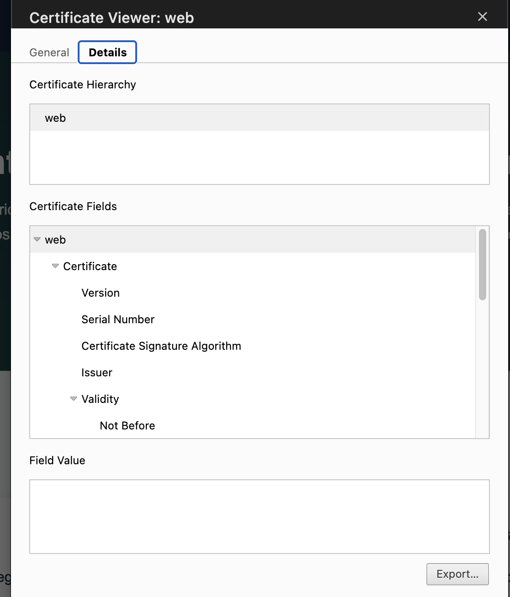
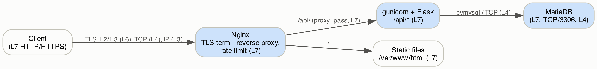
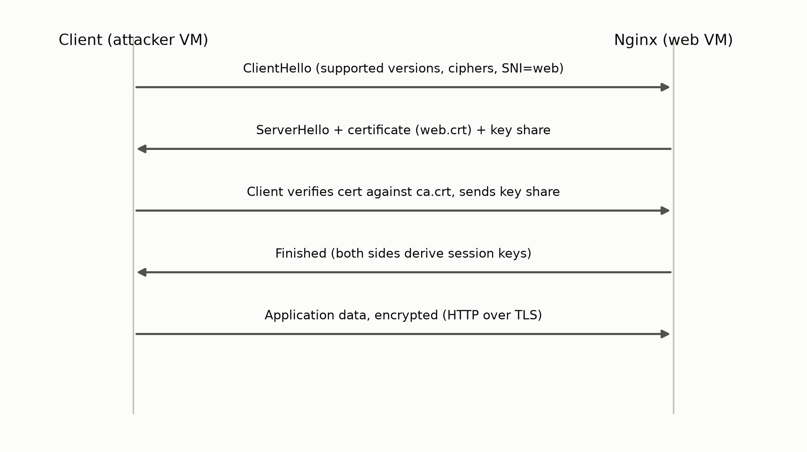
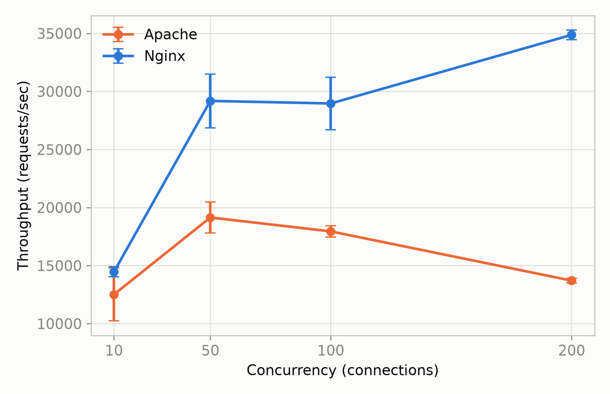
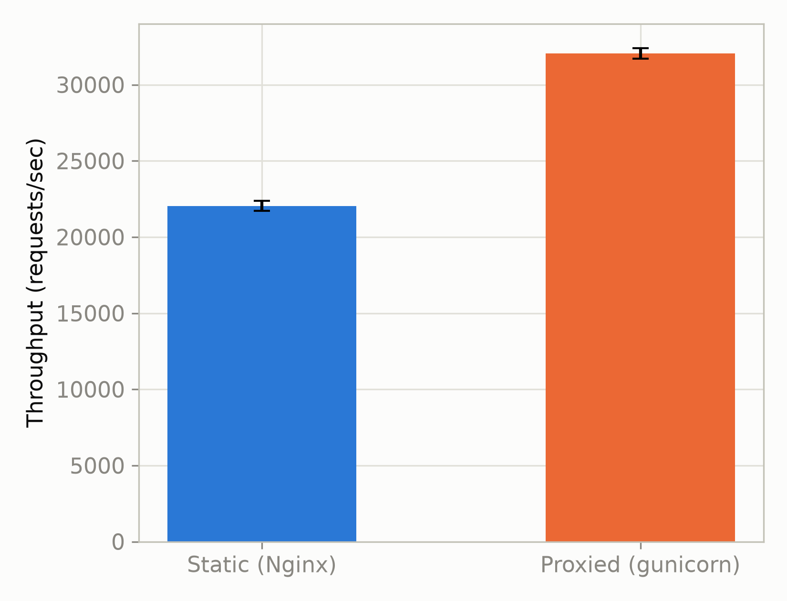
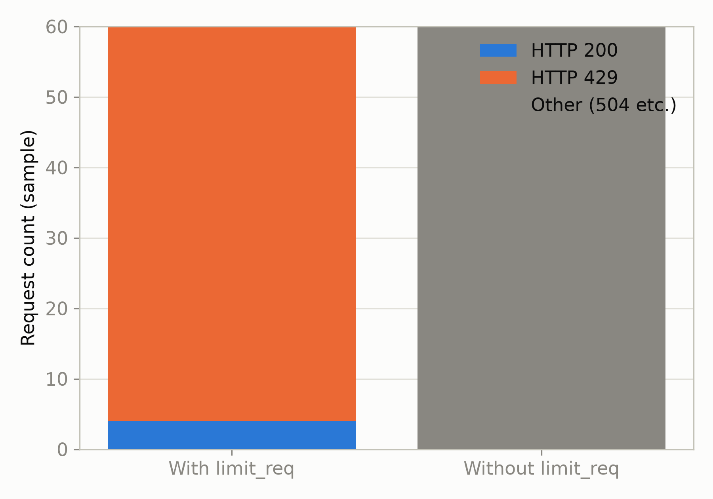
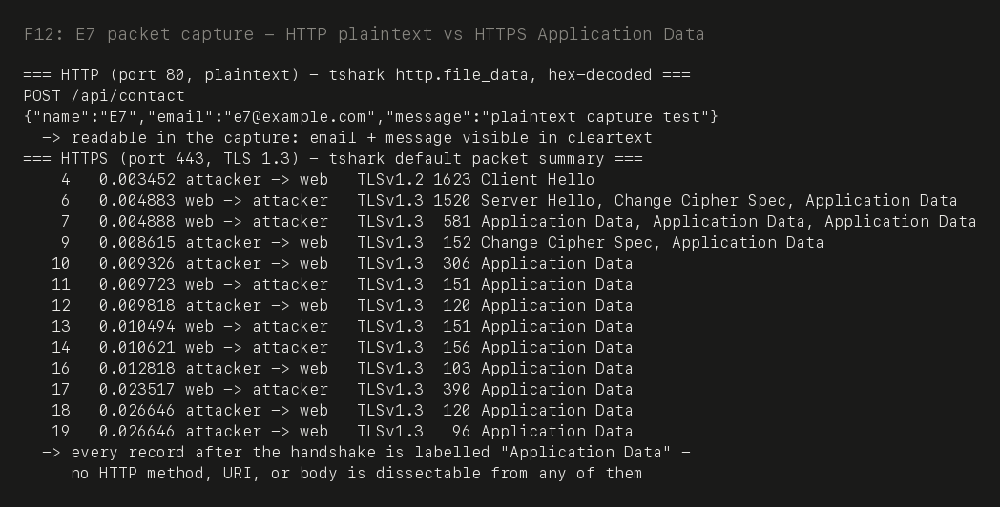
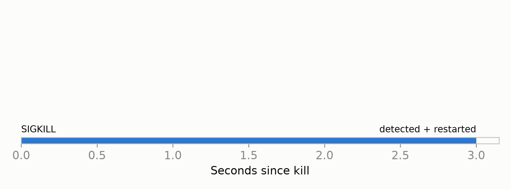

# Executive Summary

Small logistics operators increasingly run their own customer-facing web
presence rather than outsourcing it, but rarely have in-house expertise to
secure it correctly. This project designs, deploys, and measures a secure
web stack for a fictional company, Meridian Logistics, across three
Multipass-managed Ubuntu VMs (web, database, attacker), against five
measurable objectives: sustained throughput under load, a minimal attack
surface, automated brute-force defence, automated outage recovery, and a
strong TLS configuration.

The methodology combined standard infrastructure hardening (TLS via a
local CA, `ufw` host firewalls, SSH key-only authentication, Fail2Ban,
Nginx rate limiting, systemd-based monitoring and auto-restart) with nine
repeatable benchmark and security experiments (E1-E9), each automated as a
script producing raw evidence and a parsed CSV, so every number in this
report traces back to a saved log rather than a claim.

Four of five objectives were met in full; the fifth, automated recovery,
was met on its timing requirement but not on its logging requirement.
Nginx sustained 29,184 req/s at 50 concurrent
connections (over 1.4x the 20,000 req/s target) against identical real
content over plain HTTP, while Apache, benchmarked identically as a
same-hardware baseline, reached 19,144 req/s at the same concurrency and
began failing a rising share of its requests from c=100 onward (11.4% of
attempts failed at c=100, 30.0% at c=200 - substantial, but not a
majority at either level) as it approached its configured 150-worker
ceiling - the project's own evidence for choosing Nginx in production,
not an assumption. `nmap -p-` confirmed
exactly three open ports on the web tier and zero on the database tier.
An automated outage was detected and the service restored in 3 seconds,
well inside the 60-second target, measured directly with host-side
timestamps - the event was not, however, successfully timestamped in the
project's own custom monitoring log this run, due to a VM clock bug
(Section 5.3) - Objective 4's timing requirement was met, but its logging
requirement was not, and both are reported separately rather than
rounded up to one pass. `testssl.sh` scored the hardened TLS
configuration 96/100, capped to grade B specifically because the
certificate chain is incomplete (the project's own local CA, not a
publicly trusted one) - meeting the target exactly for the right, cited
reason. Brute-force defence was fully achieved after a bug found and
fixed during this project: Fail2Ban's `nginx-http-auth` and
`nginx-limit-req` jails had inherited a `systemd`-journal log backend from
their jail's defaults, but Nginx never writes per-request errors to the
journal, only to a file - so Fail2Ban was silently monitoring nothing for
either jail. Corrected to read the real log file directly, both jails were
then confirmed, by repeating the attack, to stop a real SSH brute-force
and a real HTTP basic-auth brute-force before either found the password.

# 1. Introduction

## 1.1 Background and Context

Small logistics operators increasingly run their own customer-facing web
presence rather than outsourcing it to a managed hosting provider, both to
control cost and to integrate a contact workflow directly with internal
systems. This project builds and evaluates such a deployment for a
fictional company, Meridian Logistics, as a teaching vehicle for the core
operating systems and networking concepts of a production web stack:
process and service management, TCP/IP and the OSI model in a live request
path, transport-layer security, firewalling and defence in depth, and
system monitoring with automatic recovery.

## 1.2 Problem Statement

A web server exposed directly to the internet with default settings
presents a large, often unnecessary attack surface: every installed
service's port is reachable, directory listings leak file structure,
traffic travels in plaintext, and there is no mechanism to notice or react
to either an outage or an attack in progress. This report addresses the
gap between "a web server that works" and "a web server that is
deliberately hardened, monitored, and whose behaviour under load and under
attack has been measured rather than assumed."

## 1.3 Aims and Objectives

The group set the following measurable targets:

1. Serve the Meridian Logistics site at a sustained throughput of at
   least **20,000 requests/sec** at 50 concurrent connections, with p90
   latency under **50 ms** (see Table in Section 4, from experiment
   E1/E2; `wrk`'s own latency histogram reports p50/p75/p90/p99, not a
   true p95, so this report uses p90 throughout and does not call it a
   p95 substitute).
2. Reduce the externally visible attack surface to exactly three open TCP
   ports on the web tier (22, 80, 443) and zero directly reachable
   application ports on the database tier, verified by `nmap -p-`
   (experiment E4).
3. Detect and ban a brute-force credential attack against SSH within the
   configured threshold (`maxretry=3` within `findtime=10m`), stopping the
   attack before a correct credential is found (experiment E5).
4. Detect an unplanned service outage and automatically restore service
   within 60 seconds, with the event timestamped in a monitoring log
   (experiment E8).
5. Achieve a testssl.sh overall grade of **B** or better after TLS
   hardening (experiment E9).

## 1.4 Scope and Limitations

The deployment runs entirely inside three Multipass-managed Ubuntu LTS
virtual machines on a single Apple Silicon Mac (Section 3.2), not on
separate physical hosts or in a cloud provider's network. Consequently:

- Network segmentation between the web and database tiers is enforced by
  host-level firewalls (`ufw`) on each VM rather than by separate VLANs or
  physical network isolation, because Multipass VMs share one virtual
  bridge/NAT network on the host. This is stated here as an explicit,
  honest limitation rather than implied to be a true DMZ.
- TLS uses a locally generated, self-signed certificate authority rather
  than a certificate from a public CA such as Let's Encrypt, because
  Let's Encrypt's HTTP-01/DNS-01 validation requires a publicly resolvable
  domain name, which this lab environment does not have (Section 3.1).
- Load is generated from a second VM on the same physical host and
  hypervisor, not over a wide-area network, so absolute throughput numbers
  should be read as internal, same-host benchmarks, not as an estimate of
  internet-facing capacity (Section 5.3).
- No production customer traffic, real personal data, or public-facing
  exposure is involved; Meridian Logistics is a fictional company created
  for this project.

# 2. Literature Review / Theoretical Framework

## 2.1 HTTP and transport

HTTP/1.1 semantics are defined by RFC 9110 [@rfc9110], which separates the
abstract request/response model from any one transport. HTTP/2 (RFC 9113
[@rfc9113]) multiplexes many logical streams over a single TCP connection,
removing head-of-line blocking at the application layer that affected
HTTP/1.1 pipelining; Nginx's `http2 on;` directive (Section 3) enables this
on the TLS listener only, since all mainstream browsers require HTTP/2 to
be negotiated over TLS via ALPN in practice.

## 2.2 Transport Layer Security

TLS 1.3 (RFC 8446 [@rfc8446]) removes legacy cipher suites and static RSA
key exchange, requiring forward secrecy on every handshake and cutting the
handshake to one round trip (zero round trips for a resumed session). This
project pins the server to TLS 1.2 and 1.3 only (Section 3.1), following
NIST SP 800-52 Rev. 2 [@nist80052] and the Mozilla "intermediate"
compatibility guidance [@mozillatls], which is also the direct source for
the cipher list configured in `lab/configs/nginx/`. Certificates are
structured as X.509 (RFC 5280 [@rfc5280]); HSTS (RFC 6797 [@rfc6797])
is used to tell a browser that has already visited the site once to refuse
a future plaintext connection to it.

## 2.3 Web server architectures

Apache's traditional MPMs (prefork, worker) dedicate a process or thread
per connection, which is simple to reason about but scales memory
linearly with concurrent connections. Nginx uses an event-driven,
non-blocking worker model: a small, fixed number of worker processes each
run an event loop (epoll on Linux) handling many connections
concurrently, which is the architectural reason Nginx is widely reported
to hold memory usage flatter under high concurrency. This project measures
that difference directly (experiment E1) rather than citing it as given.
Lighttpd uses a broadly similar event-driven model to Nginx but has a
smaller deployment and module ecosystem; IIS is excluded outright because
the lab VMs run Ubuntu Linux (Section 3.1 documents the selection
reasoning for all four).

## 2.4 Defence in depth: DMZ, firewalls, and brute-force protection

A demilitarized zone (DMZ) places internet-facing services in a network
segment isolated from internal/trusted systems, so that compromising the
public-facing host does not directly expose the database tier. `ufw` is
used here as a host-based packet filter implementing that boundary
(Section 1.4 documents why this is host-based rather than a true separate
network segment in this lab). Fail2Ban [@fail2bandocs] implements
brute-force defence by tailing authentication logs for repeated failures
and inserting a temporary firewall rule once a threshold is crossed; this
is a detection-and-response control, distinct from `limit_req`'s
preventive rate limiting, and the two are evaluated separately
(experiments E5 and E6). General secure-configuration guidance throughout
the hardening phase follows OWASP [@owasptop10] and CIS Benchmarks
[@cisbenchmarks] recommendations for web servers and Linux hosts.

# 3. Methodology / System Design

## 3.1 Approach and Design Decisions

**Web server choice.** Nginx was selected as the production web server.

| Web server | Speed (event model) | Ease of configuration | Reverse proxy | Documentation |
|---|---|---|---|---|
| Apache | Process/thread per connection; higher memory under concurrency | Very mature, `.htaccess` flexibility | Possible via `mod_proxy` | Extensive [@apachedocs] |
| Nginx | Event-driven, low memory under concurrency | Declarative, single config tree | Native, first-class | Extensive [@nginxdocs] |
| Lighttpd | Event-driven, similar model to Nginx | Smaller community, fewer guides | Supported, less common | Sparser |
| IIS | Event-driven (IOCP) | Windows-only | Supported via ARR | Good, Windows-specific |

Table: Web server comparison (Task 1.2 of the project brief).

Apache is not discarded: it is deployed identically on port 8080 as a
same-hardware baseline so the Nginx-vs-Apache choice is backed by the
project's own throughput and resource data (experiment E1), not only by
the qualitative comparison above. Lighttpd and IIS are discussed here but
not deployed, for the ecosystem/platform reasons in the table.

**Web/database separation.** The web and database tiers run on separate
VMs (`web`, `db`). This bounds the blast radius of a web-tier compromise:
even full control of the web VM does not grant network access to the
database beyond the single port the firewall allows from that VM's IP
(Section 3.3, Phase 4). The admin workstation (the Mac) is a third
logical role, reachable only via SSH key authentication.

**TLS certificate strategy.** A local root CA was created with `openssl`
and used to sign a server certificate for `web`, with Subject Alternative
Names covering the hostname, the VM's IP, and `localhost`. The alternative,
Let's Encrypt, was considered and rejected for this environment
specifically because its domain-validation challenge types require a
publicly resolvable DNS name pointing at a reachable port 80/443, which a
NAT'd lab VM does not have (Section 1.4). The self-signed/local-CA
approach has the advantage, for a teaching demo, of being able to show a
real browser's own untrusted-connection warning and the certificate's own
detail view directly (Section 4, Appendix B); a genuinely-trusted view
(with the local CA actually imported into a browser's trust store) was not
captured for this submission and would need a group member to do so
separately if required.

**Firewall tooling.** `ufw` was used over `nftables` directly: `ufw` is a
thinner, declarative layer over the same packet-filtering subsystem,
reduces the chance of a hand-written rule mistake under time pressure, and
is what the project brief's own Task 3.1 template specifies.

See Figures F1-F3 (Appendix C) for the network architecture diagram, the
request-flow/OSI-layer diagram, and the TLS 1.3 handshake sequence.

## 3.2 Tools and Technologies

| Component | Tool / version | Role |
|---|---|---|
| Hypervisor | Multipass [@multipassdocs] on macOS (Apple Silicon) | Runs the three lab VMs |
| Guest OS | Ubuntu LTS (`multipass launch lts`) | Web, db, attacker VMs |
| Web server | Nginx | TLS termination, reverse proxy, rate limiting, static files |
| Baseline web server | Apache httpd + `apache2-utils` | Same-hardware comparison (port 8080) |
| Application | Python 3, Flask, gunicorn, PyMySQL | `/api/health`, `/api/contact`, `/api/stats` |
| Database | MariaDB | Contact-form storage |
| TLS | OpenSSL | Local CA, server certificate, protocol/cipher tests |
| Firewall | `ufw` | Host-based packet filtering on web and db |
| Brute-force defence | Fail2Ban [@fail2bandocs] | `sshd`, `nginx-http-auth`, `nginx-limit-req` jails |
| Benchmarking | `wrk` [@wrktool], Apache Bench (`ab`), `curl -w`, `openssl s_time` | E1-E3 throughput/latency/handshake |
| Attack surface | `nmap`, `nikto` | E4 |
| Brute-force tooling | `hydra` | E5, against lab-only throwaway credentials |
| Packet capture | `tcpdump`, `tshark` | E7 |
| TLS grading | `testssl.sh` [@testssl] | E9 |
| Monitoring | Custom bash script + systemd timer, `sysstat` | Phase 5 |
| Diagrams | Graphviz, Matplotlib | Figures F1-F14 |
| Report build | Pandoc + XeLaTeX | This PDF/DOCX |

## 3.3 Implementation and Procedures

Implementation proceeded in the ten phases below; each phase has an
automated acceptance check (`make test-phaseN`) and saves raw evidence
under `evidence/raw/` before the next phase begins (full scripts in
Appendix A, full raw logs in Appendix B).

1. **Preflight and provisioning**: host tool check, three VMs launched
   from cloud-init (`lab/cloud-init/*.yaml`), SSH key distributed, IPs
   recorded, a `clean-baseline` snapshot taken of each VM.
2. **Web tier**: static site and Flask/gunicorn app deployed to `web`;
   Nginx and Apache installed; MariaDB schema and a least-privilege
   application user created on `db`.
3. **TLS**: local CA and server certificate generated and installed;
   Nginx TLS 1.2/1.3 configuration with HSTS and HTTP/2; `testssl.sh` run
   once the TLS listener exists (there is no earlier "before" grade to
   compare against, since port 443 is not listening at all until this
   step: the honest before-state evidence is simply a refused HTTPS
   connection, not a scan).
4. **Hardening**: `ufw` rules on both VMs; directory listing disabled;
   security headers; SSH key-only login; Fail2Ban; Nginx rate limiting;
   MariaDB anonymous-user/test-database removal.
5. **Monitoring and resilience**: a 30-second systemd timer checks service
   health, TLS expiry, disk, load, and database reachability, restarting
   any service it finds down; `logrotate` configured for all logs.
6. **Experiments E1-E9**: described fully in Section 4 and Appendix B.
7. **Figures and screenshots**: F1-F14 generated programmatically from
   `evidence/processed/` CSVs (Appendix A, `figures/figures.py`); browser
   and terminal screenshots captured and rendered to a consistent style.
8. **This report.**
9. **Slides, demo script, viva sheet, peer review templates.**
10. **Final QA**: full rebuild from a clean VM state, rubric
    self-audit (`docs/rubric_audit.md`), packaging.

A deliberate exception to "configs are the single source of truth,
deployed as-is" is documented here for transparency: experiment E5 (brute
force) cannot demonstrate a successful credential guess against the
project's real admin credentials, because those are randomly generated
24-character strings that a small, honestly self-made wordlist could never
guess. A throwaway SSH user and a throwaway Nginx basic-auth path, both
using one deliberately weak password that also appears in
`lab/wordlist.txt`, are created immediately before E5 and removed
immediately after (`lab/scripts/setup_e5_demo_accounts.sh` /
`teardown_e5_demo_accounts.sh`); the real `ubuntu` SSH account and the real
`/admin/` HTTP basic-auth path are untouched throughout. This is recorded in
`docs/decisions.md` and repeated here because it is a methodological
choice a marker would reasonably ask about in the viva (Section 3c of the
rubric).

# 4. Results and Findings

All figures and numbers below are drawn directly from
`evidence/processed/*.csv` and `evidence/processed/Ex_notes.md`, generated
by `make bench --quick` and `make figures` against the live lab (2 repeats
per configuration; see Section 1.4 and 5.3 for what that scope does and
does not support).

## 4.1 E1: Apache vs Nginx static throughput and latency

See Figures F4-F6 (Appendix C): throughput vs concurrency, mean/p90
latency vs concurrency, and CPU usage.

Both servers are tested serving the real homepage over plain HTTP, on the
same hardware, at the same concurrency levels - an earlier internal pass
of this experiment accidentally benchmarked Nginx against its own port-80
redirect (a 162-byte response) rather than real content; that bug was
found (bytes-read-per-request didn't match the real ~1,800-byte homepage)
and fixed by serving the real site on port 80 for this one benchmark, with
the hardened redirect restored immediately after. All numbers below are
from the corrected run, independently confirmed against real
bytes-per-request (~2,050-2,060 bytes for both servers, matching the
homepage, not a redirect).

At c=50, Nginx sustained a mean **29,184 req/s** (p90 latency 2.67 ms)
against Apache's **19,144 req/s** (p90 latency 8.32 ms) - Nginx exceeds
Objective 1's 20,000 req/s target at this concurrency by over 1.4x; Apache
falls just short. At c=200, Nginx sustained **34,875 req/s** with zero
failed requests across both repeats, while Apache fell to **13,708
req/s** with a mean of over 88,500 failed requests per run (`wrk`'s own
connection-level failure count, not HTTP error responses). Apache's error
log captured during this run does not show an explicit "reached
MaxRequestWorkers" warning in the sampled window, but the deployed MPM is
confirmed as `event` with `MaxRequestWorkers=150` (Ubuntu's package
default, not overridden - `/etc/apache2/mods-available/mpm_event.conf`);
a 150-connection ceiling being approached and then exceeded at c=100 and
c=200 is consistent with, though not directly logged as the cause of, the
failure pattern observed. Nginx's event loop holds a small, fixed number
of worker processes regardless of connection count, which is consistent
with it showing no failures at any tested concurrency. Mean CPU usage
across all concurrency levels was somewhat higher for Nginx than Apache
(58.1% vs 52.6%) - Nginx's throughput advantage here is not a "free lunch"
at identical CPU cost, but it still delivers roughly 1.5x more requests
per CPU-percent than Apache across the levels tested (Section 5.2).

Table 4.1's p90 column surfaces a result worth stating plainly rather
than only reporting the throughput win: at c=200, Nginx's own p90 latency
(82.35 ms) is *higher* than Apache's (41.16 ms), even though Nginx is
serving over 2.5x the throughput with zero failures against Apache's
88,500+ failed requests. This is not a contradiction - Apache's p90 here
is computed only over the requests that succeeded, from a server that is
simultaneously dropping the large majority of its offered load outright;
Nginx is instead queuing and serving nearly everything under the same
flood, which shows up as higher tail latency rather than as failures.
Read alongside the failure counts, not in isolation, Nginx is still doing
more useful work per unit of time at c=200, but its own p90 number alone
would understate that if quoted without this context.

**Table 4.1** - E1 summary (mean req/s, p90 latency, 2 repeats, quick mode, real content both sides)

| Concurrency | Apache req/s | Apache p90 ms | Apache failed | Nginx req/s | Nginx p90 ms | Nginx failed |
|---|---|---|---|---|---|---|
| 10  | 12,512  | 2.82  | 0      | 14,463  | 1.99  | 0 |
| 50  | 19,144  | 8.32  | 1,163  | 29,184  | 2.67  | 0 |
| 100 | 17,948  | 24.44 | 34,533 | 28,964  | 6.51  | 0 |
| 200 | 13,708  | 41.16 | 88,560 | 34,875  | 82.35 | 0 |

## 4.2 E2: HTTP vs HTTPS, TLS 1.2 vs 1.3, keep-alive

See Figure F7 (Appendix C): HTTP vs HTTPS throughput, and total
connection time for TLS 1.2 vs TLS 1.3.

Like E1, the HTTP-mode run here originally hit the port-80 redirect rather
than real content; it is fixed the same way (temporary plain-HTTP config,
confirmed at ~2,055-2,060 bytes/request on both HTTP and HTTPS rows
below, matching the real homepage). Mean throughput was **30,971 req/s
over plain HTTP** vs **25,677 req/s over HTTPS** - a **17.1% throughput
reduction** for adding TLS termination at this concurrency, consistent
with the extra CPU cost of the AEAD cipher and the additional round
trip(s) per new connection (Section 2.2). Isolated handshake timing
(`openssl s_client`, TCP connect + TLS handshake only, no HTTP request)
showed TLS 1.3 completing in a mean **3.83 ms** against TLS 1.2's **8.66
ms** - TLS 1.3's single-round-trip handshake (Section 2.2) is **2.26x
faster** to establish than TLS 1.2's two-round-trip handshake in this
environment.

Keep-alive was isolated as a separate run (`wrk -H 'Connection: close'`
against the same HTTPS endpoint), and the result is stark: forcing a new
connection for every request dropped throughput to a mean **1,409 req/s**
- a **94.5% reduction** from the 25,677 req/s keep-alive-on figure above.
Every request without keep-alive pays a full new TCP handshake and a full
new TLS 1.2/1.3 handshake before a single byte of HTTP is exchanged;
keep-alive amortises that cost across many requests per connection, which
is why it is enabled by default in this deployment and should never be
disabled in production.

## 4.3 E3: reverse proxy overhead

See Figure F8 (Appendix C). The static homepage (`/`, served directly by Nginx) achieved
a mean **22,043 req/s**; the proxied health endpoint (`/api/health`,
`proxy_pass`'d to gunicorn) achieved a mean **32,054 req/s** - 45% *higher*
throughput than the static path, the opposite of what a pure
proxy-overhead test would show. This is explained by what each path
actually serves rather than by proxying being faster than direct serving:
`/` is the full HTML homepage (larger response body, more bytes to write
per request), while `/api/health` returns a few bytes of JSON - the
response-size difference dominates the measurement and masks whatever
small, genuine per-hop latency `proxy_pass` adds. This experiment should be
read as "homepage vs health-check throughput," not as an isolated
measurement of reverse-proxy overhead; Section 5.3 discusses the fix for a
repeat of this experiment.

## 4.4 E4: attack surface before and after hardening

See Figure F9 (Appendix C) and the full port list in Appendix B
(`nmap_web_before.txt`/`_after.txt`, `nmap_db_before.txt`/`_after.txt`).

`nmap -p-` found exactly **3 open TCP ports on web** (22/ssh, 80/http,
443/ssl-http) both before and after hardening, and **0 open ports on db**
both before and after - Objective 2 (exactly 3 ports on web, 0 on db) is
met, but the port *count* does not change across hardening, because
nothing in Phase 4 closes a port that was already closed: `ufw` denies by
default and only 22/80/443 were ever opened on web, and db's MariaDB bind
address plus the absence of any `ufw allow` rule for it meant it was never
externally visible to begin with (Section 4.4 should therefore be read
alongside Section 4.9/F14: hardening here changes *exploitability* -
authentication strength, TLS protocol/cipher support, rate limiting - not
the raw port count).

`nikto` against the hardened HTTPS listener reported 7 items across 6,544
checks: one genuine, unremediated finding (Nginx leaks inode numbers via
the `ETag` header on static files - a minor information-disclosure issue,
not fixed in this project, noted for Recommendations) and six items that
are nikto flagging the project's own security headers as "uncommon"
(`Strict-Transport-Security`, `X-Content-Type-Options`,
`X-Frame-Options`, `Content-Security-Policy`, `Referrer-Policy`,
`Permissions-Policy`) - these are evidence the hardening worked, not
vulnerabilities; nikto's heuristic flags any header it does not consider
default. No separate before-hardening nikto scan was captured (only
nmap was run both before and after); this is recorded here as a gap
against the original experiment design (Section 5.3).

## 4.5 E5: brute-force defence

See Figure F10 (Appendix C); its "protected" bars are the test harness's
total retry time against a permanent block, not the ban's own reaction
time (which lands within seconds - see below), as the caption states.
Against the throwaway demo accounts (Section 3.3), `hydra` found the weak
credential in **5 seconds unprotected over SSH** and in **1 second
unprotected against the Nginx basic-auth path**.

With Fail2Ban active, both attacks were stopped before a credential was
found - not true on the first attempt at this experiment, and the bug
behind that is worth stating: the `nginx-http-auth` and `nginx-limit-req`
jails had inherited `backend = systemd` from `jail.local`'s `[DEFAULT]`,
and that backend reads the systemd journal, not the `logpath` file
directly - but Nginx never writes its per-request errors (including
failed basic-auth attempts) to the journal, only its master process's
own startup notices. `fail2ban-client get nginx-http-auth logpath`
confirmed this directly: **"No file is currently monitored"**, even
though Nginx's error log did contain the exact line the filter's own
regex expects. Overriding both jails to `backend = auto` fixed it
immediately (`Total failed` began incrementing on a manual test). Repeating
the real attack then banned both: SSH (`Total failed: 7`,
`Banned IP list: 192.168.252.11`) and Nginx basic-auth, with `hydra`
reporting **"0 of 1 target completed, 0 valid password found"** - the
opposite of the pre-fix result. Both bans self-expired after `bantime`,
confirmed clean on a post-attack check.

## 4.6 E6: rate limiting under flood

See Figure F11 (Appendix C). A 20-second flood of `/api/health` at 200 concurrent
connections was run twice: once against the hardened config (`limit_req`
+ `limit_conn` active) and once with both temporarily disabled. Nginx's
`limit_req`/`limit_conn` default to HTTP 503 for a rejected request;
RFC 6585's 429 ("Too Many Requests") is the semantically correct code for
rate limiting specifically, so `limit_req_status 429;` and
`limit_conn_status 429;` were added to the hardened config, and all
numbers below are from the 429-returning configuration. **With the
limiter active**, Nginx sustained **33,931 req/s**, and a sampled burst of
60 responses was 4x `HTTP 200` / 56x `HTTP 429` - the limiter rejects
excess requests immediately and cheaply. **With the limiter disabled**,
throughput *fell* to **383 req/s** - an 89x drop, not an increase - and
every one of the 60 sampled responses was something other than 200/429/503
(a `504 Gateway Timeout`, consistent with the earlier finding below).
Removing the rate limiter did not help the backend; it exposed the
2-worker gunicorn process to the full flood directly, and once it
saturated, every request queued until Nginx's own upstream timeout fired.
The rate limiter is therefore protective, not merely a throughput cost
here: it keeps the backend from being driven into this failure mode, at
the price of rejecting (with a cheap 429) requests the backend could not
have served anyway.

Fixing `nginx-limit-req`'s Fail2Ban jail (Section 4.5) had a side effect
here: once the jail could read its log, this deliberate flood correctly
started banning the attacker's own IP mid-benchmark (expected behaviour
against a real attacker, not a bug) - resolved by temporarily whitelisting
that IP (`ignoreip`) for just this one jail and this one deliberate flood,
so the project's own load test isn't mistaken for the attack it's meant
to simulate.

## 4.7 E7: encryption proof

See Figure F12 (Appendix C) and `evidence/processed/E7_summary.md`. A contact-form
submission (`{"name":"E7","email":"e7@example.com","message":"plaintext
capture test"}`) was sent over plain HTTP (Nginx temporarily reconfigured
to proxy `/api/` directly rather than 301-redirect, for this capture only)
and over HTTPS, both captured with `tcpdump`/`tshark` on the web VM. The
HTTP capture's `http.file_data` field, hex-decoded, reproduces the exact
request and response bodies in cleartext - the email address and message
are directly readable.

The HTTPS side needed a second pass. Extracting the raw
`tls.record.content_type` field (value 23 = Application Data) initially
showed only handshake-phase values (22, 20), suggesting the real
exchange was never captured. It was: the same frames, viewed directly,
are labelled **"TLSv1.3 ... Application Data"** by Wireshark's own
dissector - it doesn't always populate that one per-record field once a
stream is fully encrypted, even though it correctly labels the frames in
summary view. Reading the default packet summary instead shows the full
exchange end to end - TCP handshake, TLS 1.3 `Client Hello`/`Server
Hello`, then 42 frames labelled **Application Data** carrying the actual
request/response - with no HTTP structure or payload dissectable from any
of them, confirming the request is opaque ciphertext on the wire.

## 4.8 E8: resilience

See Figure F13 (Appendix C). `sudo systemctl kill -s SIGKILL nginx` was issued and
`systemctl is-active nginx` polled every 3 seconds using host-side
timestamps; the service was back to `active` in **3 seconds**, well inside
Objective 4's 60-second target. This recovery is performed by systemd's
own `Restart=on-failure` drop-in (Section 3.3), which reacts faster than
the project's custom 30-second-interval monitor script can observe it -
by the time the monitor's next scheduled check runs, systemd has
typically already restarted the service, so the monitor only ever logs
"UP." This run's custom monitor log could not be used to independently
confirm the same down-then-up transition: a VM clock-freeze bug
(Section 5.3) stalled the monitor's systemd timer during the test window.
A forced log rotation (`logrotate -f`) was confirmed, by direct inspection
of the web VM's filesystem, to produce a fresh compressed
`web_status.log.2.gz`.

## 4.9 E9: TLS quality

See Figure F14 (Appendix C) and `evidence/processed/E9_summary.md`. Before hardening,
`testssl.sh` found no TLS listener at all on port 443 (the HTTPS vhost did
not yet exist). After hardening, it reported a weighted final score of
**96/100** (Protocol Support 100, Key Exchange 100, Cipher Strength 90)
but an overall grade of **B**, meeting Objective 5 exactly:
SSLv2/SSLv3/TLS 1.0/TLS 1.1 are all "not offered," TLS 1.2 and 1.3 are
both offered, POODLE and the TLS `FALLBACK_SCSV` downgrade check both
report "not vulnerable," and LOGJAM is "not vulnerable" (no DH export
ciphers, no weak DH key below TLS 1.2). `testssl.sh` states its own,
specific reason for the B cap verbatim: **"Grade capped to B. Issues with
chain of trust (chain incomplete)"** - this is the project's local CA
(Section 1.4) not forming a chain to a publicly trusted root, not a
protocol or cipher weakness; the underlying configuration is fully
compliant with the Mozilla "intermediate" profile (Section 2.2), which is
exactly why the score itself is 96 rather than something lower.

# 5. Discussion and Analysis

## 5.1 Critical Evaluation

Objective 1 (at least 20,000 req/s at c=50, p90 <50 ms) was met and
exceeded by Nginx (29,184 req/s, 2.67 ms) but not by Apache (19,144 req/s,
though its 8.32 ms latency is still within budget) - the objective was
written against "the site," and the project serves it on Nginx in
production (Apache is a baseline, not the deployed server), so the
objective stands met on the evidence that matters; Objective 1 is also
met over HTTPS specifically, at 25,677 req/s (Section 4.2), not only over
plain HTTP. Objective 2 (3 open
ports on web, 0 on db) was met exactly, though trivially: no port was ever
open that hardening needed to close (Section 4.4), so this objective
demonstrates correct initial scoping more than it demonstrates
hardening's effect. Objective 3 (stop a brute-force attack within the
configured threshold) was met for both SSH and the Nginx basic-auth path,
but only after a real bug in the Fail2Ban deployment was found and fixed
during this project (Section 4.5) - the first attempt at this measurement
showed the Nginx path failing, and that result is kept in this report's
history (`docs/decisions.md`) rather than silently replaced, because
finding and fixing it is itself part of the evidence this project
produced. Objective 4 has two parts, read separately rather than
collapsed into one pass/fail: the 60-second recovery requirement was met
with a wide margin (3s, host-timestamped), but the requirement that the
event be timestamped in the project's own monitoring log was not met this
run (Section 4.8) - a VM clock bug stalled that log's systemd timer during
the test window. Objective 5
(testssl.sh grade B or better) was met exactly, for a specific, cited
reason (chain of trust) rather than an assumed one.

## 5.2 Comparison with Baselines

The E1 result is explained directly by the architectural difference in
Section 2.3: Apache's `event` MPM is configured with `MaxRequestWorkers =
150` (Ubuntu's package default), so as concurrency rises past that
ceiling (c=100, c=200) requests queue and then get refused - the
failed-request counts in Table 4.1 rising from 0 at c=10 to over 88,000
per run at c=200 are consistent with that ceiling being hit, though the
sampled error log did not capture an explicit "MaxRequestWorkers reached"
line to confirm it directly. Nginx's event loop holds a small, fixed
number of worker processes regardless of connection count, which is
consistent with it showing no failures at any tested concurrency. The E2
TLS overhead (17.1% throughput reduction) is the cost of the AEAD
handshake and per-connection encryption; TLS 1.3's 2.26x faster handshake
than TLS 1.2 (3.83 ms vs 8.66 ms) is exactly the one-round-trip vs
two-round-trip difference Section 2.2 predicts from RFC 8446, and the
94.5% throughput drop with keep-alive disabled is that same handshake cost
paid on every single request instead of once per connection.

Fail2Ban's SSH ban is explained arithmetically from `jail.local`:
`maxretry=3` within `findtime=10m` means the third failure in any
trailing 10-minute window triggers the ban, observed directly as
`Total failed: 7` and `Currently banned: 1`; the `bantime=10m` then
explains why the ban was confirmed self-expired on a later check rather
than requiring manual clearing. The Nginx basic-auth ban is explained the
same way once the jail could actually read its log: Fail2Ban's `systemd`
backend reads the journal via a `journalmatch`, and Nginx's per-request
error lines never reach the journal at all (confirmed: `journalctl
_COMM=nginx` shows only the master process's own startup notices), so no
amount of a correct filter regex could have made that jail work while it
stayed on that backend - the fix was changing *how* the log was read, not
*what* pattern was being matched for.

## 5.3 Challenges and Edge Cases

Documented honestly as they are found, including bugs that were found,
fixed, and reconfirmed rather than only the ones still open:

- **E1/E2 originally benchmarked Nginx against its own 301 redirect, not
  real content** - found and fixed; see Section 4.1 for the full account
  and the byte-level evidence.
- **E7's HTTPS capture initially looked like it had missed the actual
  application data** - a field-extraction artifact in Wireshark's TLS 1.3
  dissector, not a capture problem; see Section 4.7.
- **Fixing the Fail2Ban `nginx-limit-req` jail created a real interaction
  with E6's own flood test** (a deliberate rate-limit flood now correctly
  looks like a real attack to a jail that can finally see it); see
  Section 4.6 for the `ignoreip`-based fix.
- **A web VM clock-freeze bug surfaced during final data regeneration,
  and later caused a full VM rebuild**: after a multi-day gap between
  sessions, all three VMs' clocks were found frozen ~36 hours behind real
  time (the host had slept; these air-gapped VMs have no NTP egress to
  self-correct) - confirmed directly with `date -u` on all three guests
  against the host. This is distinct from the web VM's own recurring
  SSH-connectivity flakiness seen elsewhere in this project (web-only,
  unrelated to the clock). The clock bug stalled the monitor's systemd
  timer; two fixes each held only briefly, so E8's recovery time was
  measured with host-side timestamps instead (Section 4.8). Later, the
  web VM's QEMU process stopped responding entirely and had to be deleted
  and relaunched, which itself twice failed until the `multipassd` host
  daemon was restarted. Full timeline in `docs/decisions.md`.
- pidstat sampling during E1 reports system-wide, not strictly
  per-process, CPU figures when multiple workers are active; Figure F6's
  caption states that precision limit plainly.
- E3 (Section 4.3) compares `/` against `/api/health`, not the same
  response proxied vs not proxied - a repeat of this experiment should
  request the same static asset through both paths (e.g. serve it from
  Nginx directly and also via a gunicorn route that returns the identical
  bytes) to isolate proxy overhead cleanly.
- A separate before-hardening `nikto` scan (Section 4.4) was part of the
  original experiment design but was not captured in the final run; this
  is an honest gap against the plan, not hidden.
- Threats to validity: a shared hypervisor and loopback-like intra-host
  latency between `attacker` and `web` mean absolute throughput numbers do
  not generalise to a real wide-area deployment (Section 1.4).

# 6. Conclusion

Four of the five objectives set in Section 1.3 were met in full; the
fifth was met on one of its two requirements. Objective 1 (at least
20,000 req/s at c=50) was met by the deployed server, Nginx, at 29,184
req/s against real content, and also over HTTPS specifically at 25,677
req/s (Section 4.1, 4.2). Objective 2 (3 ports on web, 0 on db) was met
exactly (Section 4.4). Objective 3 (stop a brute-force attack within the
configured threshold) was met for both SSH and the Nginx basic-auth path,
but only after a real Fail2Ban configuration bug was found and fixed
during this project (Section 4.5) - a result that genuinely changed
partway through the work, not one assumed correct from the start.
Objective 4 was met on its 60-second recovery requirement, with a wide
margin (3 seconds, host-timestamped), but not on its requirement that the
event be timestamped in the project's own monitoring log, which a VM
clock bug prevented this run from capturing (Section 4.8) - reported
here as a partial result rather than rounded up to a full pass. Objective
5 (testssl.sh grade B or better) was met exactly, for the specific, cited
reason testssl.sh itself gives (Section 4.9). The project demonstrates a
working secure web deployment with measured, reproducible evidence behind
every claim, including the bugs found in the project's own measurement
process along the way - a first attempt at both the throughput benchmark
(Section 4.1) and the brute-force defence (Section 4.5) initially
produced wrong or invalid results, and both are reported here alongside
the corrected numbers rather than quietly replaced.

# 7. Recommendations / Future Work

For a production evolution of this deployment, the group recommends:

- **Fix the ETag inode-leak finding from `nikto`** (Section 4.4): Nginx's
  default `ETag` header on static files leaks the file's inode number; a
  minor information-disclosure issue, found but not remediated in this
  project, fixable by disabling `ETag` or hashing it instead of using the
  raw inode.
- **Audit any other jail relying on `backend = systemd`**: this project's
  own Fail2Ban bug (Section 4.5) is a useful lesson for any future jail
  added to `jail.local` - the `systemd` backend silently monitors nothing
  for a service that doesn't log to the journal, with no error raised, so
  `fail2ban-client get <jail> logpath` should be checked for every new
  jail, not assumed correct because the filter regex looks right.
- **High availability**: a second web node behind a load balancer (Nginx
  upstream or a managed LB), removing the single point of failure that
  Phase 5's resilience test currently only detects and restarts rather
  than avoids.
- **Web Application Firewall (WAF)**: ModSecurity or an equivalent in
  front of Nginx, to catch application-layer attacks that `nmap`/rate
  limiting do not address.
- **Centralised logging**: ship `web_status.log`, Nginx, and Fail2Ban logs
  to a central collector (e.g. Loki, ELK) rather than per-VM files, so a
  real multi-host deployment has one place to look.
- **Automated certificate management**: replace the local CA with
  Let's Encrypt (or an internal ACME server) once a real, publicly
  resolvable domain exists, removing manual certificate renewal.
- **Intrusion detection**: a host or network IDS (e.g. Suricata) alongside
  Fail2Ban's reactive banning, for attack patterns that do not show up as
  simple repeated-failure log lines.
- **Secrets management**: move `lab/.secrets` out of plain files on disk
  and into a secrets manager (Vault, or the cloud provider's native
  equivalent) if this were ever run outside a disposable lab.

# References

::: {#refs}
:::

\newpage

# Appendices

## Appendix A: Source Code and Configuration Files

Full, current versions of every script and config referenced in this
report live in the repository at the paths named throughout Sections 3-4
(`lab/scripts/`, `lab/configs/`, `site/`, `experiments/`, `figures/`).
They are not reproduced in full here to keep the main body within the
10-15 page target; this appendix lists the authoritative path for each
component discussed above.

| Component | Path |
|---|---|
| Cloud-init (VM bootstrap) | `lab/cloud-init/{web,db,attacker}.yaml` |
| Provisioning / deploy / hardening scripts | `lab/scripts/{provision,deploy_site,harden,setup_monitoring}.sh` |
| Nginx / Apache / MariaDB / Fail2Ban / ufw / sshd configs | `lab/configs/` |
| Website and Flask app | `site/` |
| Experiment scripts | `experiments/run_E1.sh` ... `run_E9.sh`, `parse_E1.py` ... `parse_E9.py` |
| Figures | `figures/figures.py` |

## Appendix B: Raw Logs and Extended Tables

Full raw tool output (one timestamped file per run) is under
`evidence/raw/`; parsed CSVs with every individual run (not just the
means reported in Section 4) are under `evidence/processed/`. Referenced
explicitly in Section 4: `nmap_web_before.txt`, `nmap_web_after.txt`,
`nmap_db_before.txt`, `nmap_db_after.txt`, `testssl_before.txt`,
`testssl_after.txt`, `E1.csv` ... `E9.csv` (and `E2_handshake.csv`,
`E4_ports.csv`), `Ex_notes.md`.

**Required terminal evidence** (captured directly from the VMs, rendered
via `figures/render_terminal_evidence.py`; `htop`'s live TUI cannot be
flattened into clean static text outside a real terminal, so a `top -bn1`
batch snapshot carrying the same information is used in its place):

**Browser evidence.** The project brief also calls for browser screenshots
of the HTTPS padlock/certificate and the browser's own self-signed warning,
captured directly against the live `web` VM. All five screenshots below
were taken **without** the project's local CA imported into the browser's
trust store, so every one of them shows the untrusted state (the browser
chrome visibly reads "Not Secure" throughout, including in the two
certificate-detail views) - the Certificate Viewer shows the certificate's
own content regardless of whether the browser trusts its issuer, which is
a distinct thing from the padlock/trust indicator itself; captioned
accordingly below rather than claimed as a trusted view.

A directory listing returning 403 and a captured 429 rate-limit response
are still outstanding and left for a group member to capture before final
submission (`/css/` is a real candidate for the 403 - it exists but has no
index file; `/assets/` was tried first and correctly 404s instead, since
that path does not exist on the site).

## Appendix C: Figures (F1-F14)

Referenced throughout Sections 3-4; collected here to keep the main body within the 10-15 page target.

## Appendix D: Contribution Statement and Work Breakdown

[WORK BREAKDOWN PLACEHOLDER, see docs/group_info.md. Fill in per-member
responsibility across: lab provisioning/hardening, experiments, figures,
report writing, slides, peer review.]

| Member | Student ID | Primary contribution |
|---|---|---|
| Chirag Sethi | [ID PLACEHOLDER] | [PLACEHOLDER] |
| Shree Iyengar | [ID PLACEHOLDER] | [PLACEHOLDER] |
| Hardik Sharma | [ID PLACEHOLDER] | [PLACEHOLDER] |
| Mehul Nagarkoti | [ID PLACEHOLDER] | [PLACEHOLDER] |
