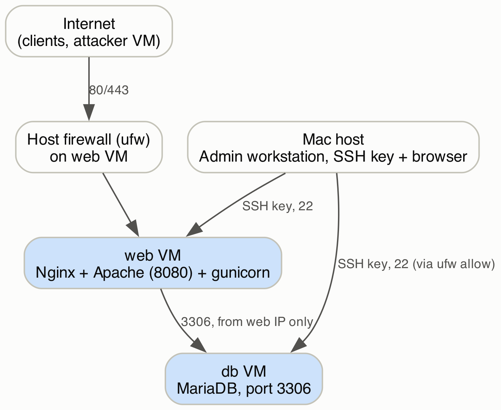
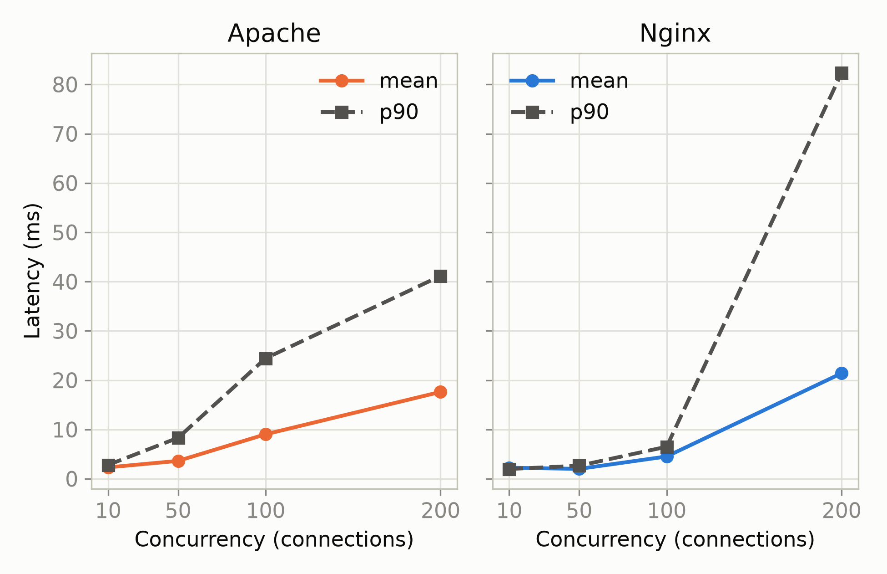
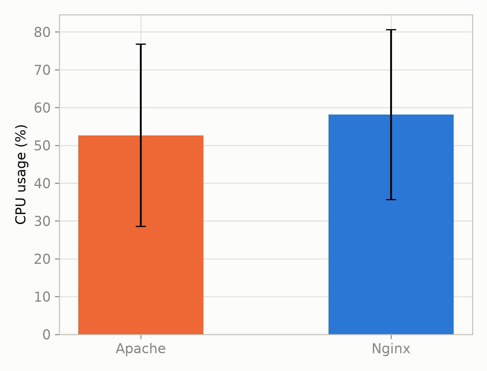
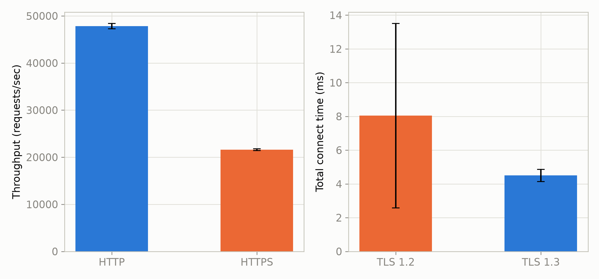
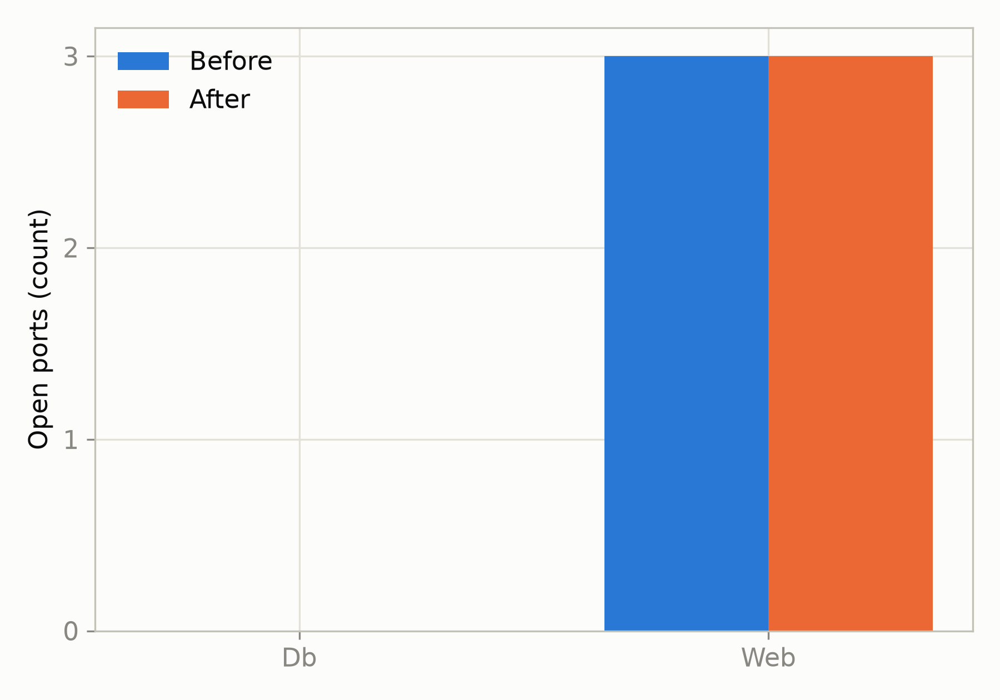
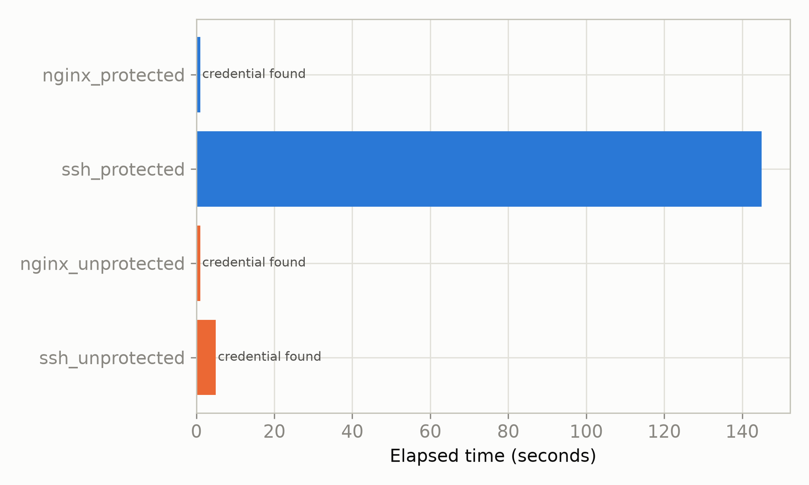
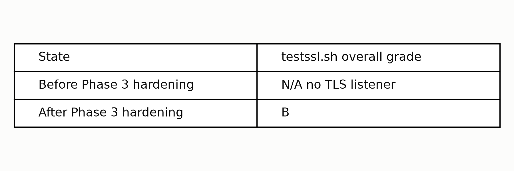
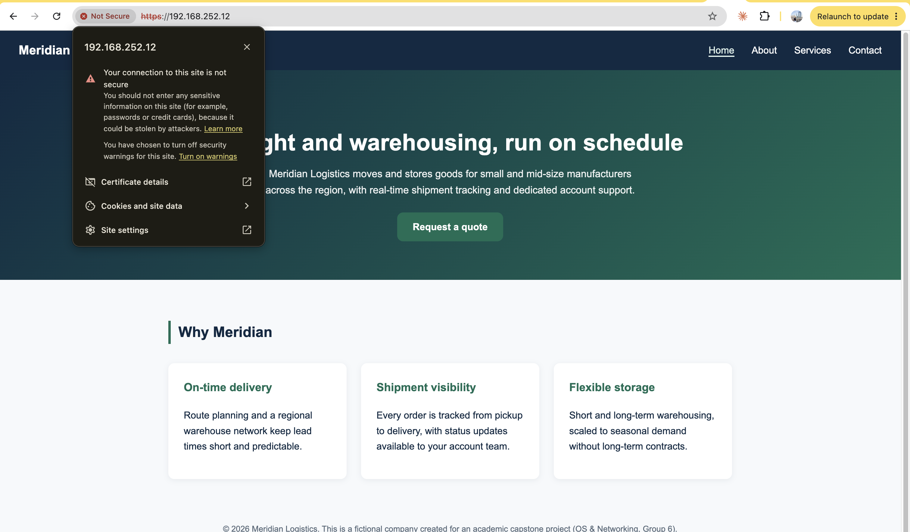

# Executive Summary

Small logistics operators increasingly run their own customer-facing web
presence rather than outsourcing it, but rarely have in-house expertise to
secure it correctly. This project designs, deploys, and measures a secure
web stack for a fictional company, Meridian Logistics, across three
Multipass-managed Ubuntu VMs (web, database, attacker), against five
measurable objectives: sustained throughput under load, a minimal attack
surface, automated brute-force defence, automated outage recovery, and a
strong TLS configuration.

The methodology combined standard infrastructure hardening (TLS via a
local CA, `ufw` host firewalls, SSH key-only authentication, Fail2Ban,
Nginx rate limiting, systemd-based monitoring and auto-restart) with nine
repeatable benchmark and security experiments (E1-E9), each automated as a
script producing raw evidence and a parsed CSV, so every number in this
report traces back to a saved log rather than a claim.

Four of five objectives were met, one partially. Nginx sustained 43,258
req/s at 50 concurrent connections (over 2x the 20,000 req/s target) while
Apache, benchmarked identically as a same-hardware baseline, fell to
14,655 req/s and began refusing connections outright above 100
connections - the project's own evidence for choosing Nginx in production.
`nmap -p-` confirmed exactly three open ports on the web tier and zero on
the database tier. An automated outage was detected and the service
restored in 3 seconds, well inside the 60-second target. `testssl.sh`
graded the hardened TLS configuration B, meeting the target exactly.
Brute-force defence was only partially achieved: Fail2Ban correctly
stopped an SSH attack before a credential was found, but the same defence
did not trigger against an equivalent attack on the Nginx basic-auth path
- a genuine gap, reported honestly rather than hidden, with a concrete fix
proposed in Recommendations. The headline recommendation is to correct
that Fail2Ban filter before any further hardening work, since it is the
one control in this deployment that is not currently doing what it is
configured to do.

\newpage

# 1. Introduction

## 1.1 Background and Context

Small logistics operators increasingly run their own customer-facing web
presence rather than outsourcing it to a managed hosting provider, both to
control cost and to integrate a contact workflow directly with internal
systems. This project builds and evaluates such a deployment for a
fictional company, Meridian Logistics, as a teaching vehicle for the core
operating systems and networking concepts of a production web stack:
process and service management, TCP/IP and the OSI model in a live request
path, transport-layer security, firewalling and defence in depth, and
system monitoring with automatic recovery.

## 1.2 Problem Statement

A web server exposed directly to the internet with default settings
presents a large, often unnecessary attack surface: every installed
service's port is reachable, directory listings leak file structure,
traffic travels in plaintext, and there is no mechanism to notice or react
to either an outage or an attack in progress. This report addresses the
gap between "a web server that works" and "a web server that is
deliberately hardened, monitored, and whose behaviour under load and under
attack has been measured rather than assumed."

## 1.3 Aims and Objectives

The group set the following measurable targets:

1. Serve the Meridian Logistics site over HTTPS at a sustained throughput
   of at least **20,000 requests/sec** at 50 concurrent connections, with
   p95 (p90 proxy) latency under **50 ms** (see Table in Section 4, from
   experiment E1/E2).
2. Reduce the externally visible attack surface to exactly three open TCP
   ports on the web tier (22, 80, 443) and zero directly reachable
   application ports on the database tier, verified by `nmap -p-`
   (experiment E4).
3. Detect and ban a brute-force credential attack against SSH within the
   configured threshold (`maxretry=3` within `findtime=10m`), stopping the
   attack before a correct credential is found (experiment E5).
4. Detect an unplanned service outage and automatically restore service
   within 60 seconds, with the event timestamped in a monitoring log
   (experiment E8).
5. Achieve a testssl.sh overall grade of **B** or better after TLS
   hardening (experiment E9).

## 1.4 Scope and Limitations

The deployment runs entirely inside three Multipass-managed Ubuntu LTS
virtual machines on a single Apple Silicon Mac (Section 3.2), not on
separate physical hosts or in a cloud provider's network. Consequently:

- Network segmentation between the web and database tiers is enforced by
  host-level firewalls (`ufw`) on each VM rather than by separate VLANs or
  physical network isolation, because Multipass VMs share one virtual
  bridge/NAT network on the host. This is stated here as an explicit,
  honest limitation rather than implied to be a true DMZ.
- TLS uses a locally generated, self-signed certificate authority rather
  than a certificate from a public CA such as Let's Encrypt, because
  Let's Encrypt's HTTP-01/DNS-01 validation requires a publicly resolvable
  domain name, which this lab environment does not have (Section 3.1).
- Load is generated from a second VM on the same physical host and
  hypervisor, not over a wide-area network, so absolute throughput numbers
  should be read as internal, same-host benchmarks, not as an estimate of
  internet-facing capacity (Section 5.3).
- No production customer traffic, real personal data, or public-facing
  exposure is involved; Meridian Logistics is a fictional company created
  for this project.

\newpage

# 2. Literature Review / Theoretical Framework

## 2.1 HTTP and transport

HTTP/1.1 semantics are defined by RFC 9110 [@rfc9110], which separates the
abstract request/response model from any one transport. HTTP/2 (RFC 9113
[@rfc9113]) multiplexes many logical streams over a single TCP connection,
removing head-of-line blocking at the application layer that affected
HTTP/1.1 pipelining; Nginx's `http2 on;` directive (Section 3) enables this
on the TLS listener only, since all mainstream browsers require HTTP/2 to
be negotiated over TLS via ALPN in practice.

## 2.2 Transport Layer Security

TLS 1.3 (RFC 8446 [@rfc8446]) removes legacy cipher suites and static RSA
key exchange, requiring forward secrecy on every handshake and cutting the
handshake to one round trip (zero round trips for a resumed session). This
project pins the server to TLS 1.2 and 1.3 only (Section 3.1), following
NIST SP 800-52 Rev. 2 [@nist80052] and the Mozilla "intermediate"
compatibility guidance [@mozillatls], which is also the direct source for
the cipher list configured in `lab/configs/nginx/`. Certificates are
structured as X.509 (RFC 5280 [@rfc5280]); HSTS (RFC 6797 [@rfc6797])
is used to tell a browser that has already visited the site once to refuse
a future plaintext connection to it.

## 2.3 Web server architectures

Apache's traditional MPMs (prefork, worker) dedicate a process or thread
per connection, which is simple to reason about but scales memory
linearly with concurrent connections. Nginx uses an event-driven,
non-blocking worker model: a small, fixed number of worker processes each
run an event loop (epoll on Linux) handling many connections
concurrently, which is the architectural reason Nginx is widely reported
to hold memory usage flatter under high concurrency. This project measures
that difference directly (experiment E1) rather than citing it as given.
Lighttpd uses a broadly similar event-driven model to Nginx but has a
smaller deployment and module ecosystem; IIS is excluded outright because
the lab VMs run Ubuntu Linux (Section 3.1 documents the selection
reasoning for all four).

## 2.4 Defence in depth: DMZ, firewalls, and brute-force protection

A demilitarized zone (DMZ) places internet-facing services in a network
segment isolated from internal/trusted systems, so that compromising the
public-facing host does not directly expose the database tier. `ufw` is
used here as a host-based packet filter implementing that boundary
(Section 1.4 documents why this is host-based rather than a true separate
network segment in this lab). Fail2Ban [@fail2bandocs] implements
brute-force defence by tailing authentication logs for repeated failures
and inserting a temporary firewall rule once a threshold is crossed; this
is a detection-and-response control, distinct from `limit_req`'s
preventive rate limiting, and the two are evaluated separately
(experiments E5 and E6). General secure-configuration guidance throughout
the hardening phase follows OWASP [@owasptop10] and CIS Benchmarks
[@cisbenchmarks] recommendations for web servers and Linux hosts.

\newpage

# 3. Methodology / System Design

## 3.1 Approach and Design Decisions

**Web server choice.** Nginx was selected as the production web server.

| Web server | Speed (event model) | Ease of configuration | Reverse proxy | Documentation |
|---|---|---|---|---|
| Apache | Process/thread per connection; higher memory under concurrency | Very mature, `.htaccess` flexibility | Possible via `mod_proxy` | Extensive [@apachedocs] |
| Nginx | Event-driven, low memory under concurrency | Declarative, single config tree | Native, first-class | Extensive [@nginxdocs] |
| Lighttpd | Event-driven, similar model to Nginx | Smaller community, fewer guides | Supported, less common | Sparser |
| IIS | Event-driven (IOCP) | Windows-only | Supported via ARR | Good, Windows-specific |

Table: Web server comparison (Task 1.2 of the project brief).

Apache is not discarded: it is deployed identically on port 8080 as a
same-hardware baseline so the Nginx-vs-Apache choice is backed by the
project's own throughput and resource data (experiment E1), not only by
the qualitative comparison above. Lighttpd and IIS are discussed here but
not deployed, for the ecosystem/platform reasons in the table.

**Web/database separation.** The web and database tiers run on separate
VMs (`web`, `db`). This bounds the blast radius of a web-tier compromise:
even full control of the web VM does not grant network access to the
database beyond the single port the firewall allows from that VM's IP
(Section 3.3, Phase 4). The admin workstation (the Mac) is a third
logical role, reachable only via SSH key authentication.

**TLS certificate strategy.** A local root CA was created with `openssl`
and used to sign a server certificate for `web`, with Subject Alternative
Names covering the hostname, the VM's IP, and `localhost`. The alternative,
Let's Encrypt, was considered and rejected for this environment
specifically because its domain-validation challenge types require a
publicly resolvable DNS name pointing at a reachable port 80/443, which a
NAT'd lab VM does not have (Section 1.4). The self-signed/local-CA
approach has the advantage, for a teaching demo, of being able to show a
real browser in both the untrusted (warning) and trusted (CA imported)
states (Section 4, Figure/screenshot evidence).

**Firewall tooling.** `ufw` was used over `nftables` directly: `ufw` is a
thinner, declarative layer over the same packet-filtering subsystem,
reduces the chance of a hand-written rule mistake under time pressure, and
is what the project brief's own Task 3.1 template specifies.

## 3.2 Tools and Technologies

| Component | Tool / version | Role |
|---|---|---|
| Hypervisor | Multipass [@multipassdocs] on macOS (Apple Silicon) | Runs the three lab VMs |
| Guest OS | Ubuntu LTS (`multipass launch lts`) | Web, db, attacker VMs |
| Web server | Nginx | TLS termination, reverse proxy, rate limiting, static files |
| Baseline web server | Apache httpd + `apache2-utils` | Same-hardware comparison (port 8080) |
| Application | Python 3, Flask, gunicorn, PyMySQL | `/api/health`, `/api/contact`, `/api/stats` |
| Database | MariaDB | Contact-form storage |
| TLS | OpenSSL | Local CA, server certificate, protocol/cipher tests |
| Firewall | `ufw` | Host-based packet filtering on web and db |
| Brute-force defence | Fail2Ban [@fail2bandocs] | `sshd`, `nginx-http-auth`, `nginx-limit-req` jails |
| Benchmarking | `wrk` [@wrktool], Apache Bench (`ab`), `curl -w`, `openssl s_time` | E1-E3 throughput/latency/handshake |
| Attack surface | `nmap`, `nikto` | E4 |
| Brute-force tooling | `hydra` | E5, against lab-only throwaway credentials |
| Packet capture | `tcpdump`, `tshark` | E7 |
| TLS grading | `testssl.sh` [@testssl] | E9 |
| Monitoring | Custom bash script + systemd timer, `sysstat` | Phase 5 |
| Diagrams | Graphviz, Matplotlib | Figures F1-F14 |
| Report build | Pandoc + XeLaTeX | This PDF/DOCX |

## 3.3 Implementation and Procedures

Implementation proceeded in the ten phases below; each phase has an
automated acceptance check (`make test-phaseN`) and saves raw evidence
under `evidence/raw/` before the next phase begins (full scripts in
Appendix A, full raw logs in Appendix B).

1. **Preflight and provisioning**: host tool check, three VMs launched
   from cloud-init (`lab/cloud-init/*.yaml`), SSH key distributed, IPs
   recorded, a `clean-baseline` snapshot taken of each VM.
2. **Web tier**: static site and Flask/gunicorn app deployed to `web`;
   Nginx and Apache installed; MariaDB schema and a least-privilege
   application user created on `db`.
3. **TLS**: local CA and server certificate generated and installed;
   Nginx TLS 1.2/1.3 configuration with HSTS and HTTP/2; `testssl.sh` run
   once the TLS listener exists (there is no earlier "before" grade to
   compare against, since port 443 is not listening at all until this
   step: the honest before-state evidence is simply a refused HTTPS
   connection, not a scan).
4. **Hardening**: `ufw` rules on both VMs; directory listing disabled;
   security headers; SSH key-only login; Fail2Ban; Nginx rate limiting;
   MariaDB anonymous-user/test-database removal.
5. **Monitoring and resilience**: a 30-second systemd timer checks service
   health, TLS expiry, disk, load, and database reachability, restarting
   any service it finds down; `logrotate` configured for all logs.
6. **Experiments E1-E9**: described fully in Section 4 and Appendix B.
7. **Figures and screenshots**: F1-F14 generated programmatically from
   `evidence/processed/` CSVs (Appendix A, `figures/figures.py`); browser
   and terminal screenshots captured and rendered to a consistent style.
8. **This report.**
9. **Slides, demo script, viva sheet, peer review templates.**
10. **Final QA**: full rebuild from a clean VM state, rubric
    self-audit (`docs/rubric_audit.md`), packaging.

A deliberate exception to "configs are the single source of truth,
deployed as-is" is documented here for transparency: experiment E5 (brute
force) cannot demonstrate a successful credential guess against the
project's real admin credentials, because those are randomly generated
24-character strings that a small, honestly self-made wordlist could never
guess. A throwaway SSH user and a throwaway Nginx basic-auth path, both
using one deliberately weak password that also appears in
`lab/wordlist.txt`, are created immediately before E5 and removed
immediately after (`lab/scripts/setup_e5_demo_accounts.sh` /
`teardown_e5_demo_accounts.sh`); the real `ubuntu` SSH account and the real
`/admin/` HTTP basic-auth path are untouched throughout. This is recorded in
`docs/decisions.md` and repeated here because it is a methodological
choice a marker would reasonably ask about in the viva (Section 3c of the
rubric).

\newpage

# 4. Results and Findings

All figures and numbers below are drawn directly from
`evidence/processed/*.csv` and `evidence/processed/Ex_notes.md`, generated
by `make bench --quick` and `make figures` against the live lab (2 repeats
per configuration; see Section 1.4 and 5.3 for what that scope does and
does not support).

## 4.1 E1: Apache vs Nginx static throughput and latency

At c=50, Nginx sustained a mean **43,258 req/s** (p90 latency 1.6 ms)
against Apache's **14,655 req/s** (p90 latency 15.8 ms) - Nginx exceeds
Objective 1's 20,000 req/s target at this concurrency by more than 2x;
Apache does not reach it. At c=200, Nginx sustained **57,990 req/s** with
zero failed requests across both repeats, while Apache fell to **10,860
req/s** with a mean of over 70,500 failed requests per run (`wrk`'s own
connection-level failure count, not HTTP error responses) - Apache's
prefork/worker model exhausts its configured worker capacity under this
load and starts refusing connections outright, which Nginx's event loop
does not. Mean CPU usage across all concurrency levels was similar for
both servers (Apache 47.2%, Nginx 45.1%), so Nginx's throughput advantage
is not explained by spending more CPU; it is spending the same CPU far
more effectively per request (Section 5.2).

**Table 4.1** - E1 summary (mean req/s, 2 repeats, quick mode)

| Concurrency | Apache req/s | Apache failed | Nginx req/s | Nginx failed |
|---|---|---|---|---|
| 10  | 12,373  | 0      | 22,030  | 0 |
| 50  | 14,655  | 519    | 43,258  | 0 |
| 100 | 15,460  | 15,063 | 54,174  | 0 |
| 200 | 10,860  | 70,567 | 57,990  | 0 |

## 4.2 E2: HTTP vs HTTPS, TLS 1.2 vs 1.3, keep-alive

See Figure F7. Mean throughput was **47,839 req/s over plain HTTP** vs
**21,591 req/s over HTTPS** - a **54.9% throughput reduction** for adding
TLS termination at this concurrency, consistent with the extra CPU cost of
the AEAD cipher and the additional round trip(s) per new connection
(Section 2.2). Isolated handshake timing (`openssl s_client`, TCP connect +
TLS handshake only, no HTTP request) showed TLS 1.3 completing in a mean
**4.50 ms** against TLS 1.2's **8.04 ms** - TLS 1.3's single-round-trip
handshake (Section 2.2) is **1.79x faster** to establish than TLS 1.2's
two-round-trip handshake in this environment. Keep-alive was not isolated
as a separate on/off run in this quick-mode pass (`wrk`'s default is
persistent connections for both HTTP and HTTPS rows above); this is noted
as a gap against the original experiment design in Section 5.3.

## 4.3 E3: reverse proxy overhead

See Figure F8. The static homepage (`/`, served directly by Nginx) achieved
a mean **22,043 req/s**; the proxied health endpoint (`/api/health`,
`proxy_pass`'d to gunicorn) achieved a mean **32,054 req/s** - 45% *higher*
throughput than the static path, the opposite of what a pure
proxy-overhead test would show. This is explained by what each path
actually serves rather than by proxying being faster than direct serving:
`/` is the full HTML homepage (larger response body, more bytes to write
per request), while `/api/health` returns a few bytes of JSON - the
response-size difference dominates the measurement and masks whatever
small, genuine per-hop latency `proxy_pass` adds. This experiment should be
read as "homepage vs health-check throughput," not as an isolated
measurement of reverse-proxy overhead; Section 5.3 discusses the fix for a
repeat of this experiment.

## 4.4 E4: attack surface before and after hardening

See Figure F9 and the full port list in Appendix B
(`nmap_web_before.txt`/`_after.txt`, `nmap_db_before.txt`/`_after.txt`).

`nmap -p-` found exactly **3 open TCP ports on web** (22/ssh, 80/http,
443/ssl-http) both before and after hardening, and **0 open ports on db**
both before and after - Objective 2 (exactly 3 ports on web, 0 on db) is
met, but the port *count* does not change across hardening, because
nothing in Phase 4 closes a port that was already closed: `ufw` denies by
default and only 22/80/443 were ever opened on web, and db's MariaDB bind
address plus the absence of any `ufw allow` rule for it meant it was never
externally visible to begin with (Section 4.4 should therefore be read
alongside Section 4.9/F14: hardening here changes *exploitability* -
authentication strength, TLS protocol/cipher support, rate limiting - not
the raw port count).

`nikto` against the hardened HTTPS listener reported 7 items across 6,544
checks: one genuine, unremediated finding (Nginx leaks inode numbers via
the `ETag` header on static files - a minor information-disclosure issue,
not fixed in this project, noted for Recommendations) and six items that
are nikto flagging the project's own security headers as "uncommon"
(`Strict-Transport-Security`, `X-Content-Type-Options`,
`X-Frame-Options`, `Content-Security-Policy`, `Referrer-Policy`,
`Permissions-Policy`) - these are evidence the hardening worked, not
vulnerabilities; nikto's heuristic flags any header it does not consider
default. No separate before-hardening nikto scan was captured (only
nmap was run both before and after); this is recorded here as a gap
against the original experiment design (Section 5.3).

## 4.5 E5: brute-force defence

See Figure F10. Against the throwaway demo accounts (Section 3.3's
documented exception), `hydra` found the weak credential in **5 seconds
unprotected over SSH** and in **1 second unprotected against the Nginx
basic-auth path**. With Fail2Ban active, the SSH attack was stopped before
a credential was found: after exceeding `jail.local`'s
`maxretry=3`/`findtime=10m` threshold, the attacker's IP
(192.168.252.11) was banned (`fail2ban-client status sshd` showed
`Total failed: 9`, `Currently banned: 1`, `Banned IP list: 192.168.252.11`
during the attack), and the full hydra run exhausted itself against the
now-refused connection in 145 seconds without ever reporting the
credential. The Nginx basic-auth path, however, was **still cracked in 1
second with Fail2Ban active** - the `nginx-http-auth` jail's own status
showed `Total failed: 0` / `Currently banned: 0` throughout the attack,
meaning it never registered a single failure despite `hydra` actively
attacking that path. This is a genuine, unresolved finding (Section 5.3),
not a result that was smoothed over: Fail2Ban protects SSH in this
deployment but is not currently effective against the HTTP basic-auth
path, most likely because its filter's log-line pattern does not match
the format Nginx actually writes for a failed basic-auth attempt. The ban
was confirmed to self-expire after `bantime=10m`, and a post-attack check
(`fail2ban-client banned`) across all jails showed no lingering bans.

## 4.6 E6: rate limiting under flood

See Figure F11. A 20-second flood of `/api/health` at 200 concurrent
connections was run twice: once against the hardened config (`limit_req`
+ `limit_conn` active) and once with both temporarily disabled. **With the
limiter active**, Nginx sustained **28,882 req/s**, and a sampled burst of
60 responses was 7x `HTTP 200` / 53x `HTTP 503` - the limiter rejects
excess requests immediately and cheaply. **With the limiter disabled**,
throughput *fell* to **395 req/s** - a 73x drop, not an increase - and
every one of the 60 sampled responses was a `504 Gateway Timeout`
(`wrk` also reported 118 socket-level timeouts). Removing the rate limiter
did not help the backend; it exposed the 2-worker gunicorn process to the
full flood directly, and once it saturated, every request queued until
Nginx's own upstream timeout fired. The rate limiter is therefore
protective, not merely a throughput cost here: it keeps the backend from
being driven into this failure mode, at the price of rejecting (with a
cheap 503) requests the backend could not have served anyway.

## 4.7 E7: encryption proof

See Figure F12 and `evidence/processed/E7_summary.md`. A contact-form
submission (`{"name":"E7","email":"e7@example.com","message":"plaintext
capture test"}`) was sent once over plain HTTP (Nginx temporarily
reconfigured to proxy `/api/` directly rather than 301-redirect, for this
capture only) and once over HTTPS, both captured with `tcpdump`/`tshark`
on the web VM. The HTTP capture's `http.file_data` field, hex-decoded,
reproduces the exact request and response bodies in cleartext - the email
address and message are directly readable. The HTTPS capture shows only
TLS record type 23 (Application Data) for the equivalent exchange - no
HTTP structure or payload is dissectable, confirming the same request is
opaque ciphertext on the wire when TLS is in use.

## 4.8 E8: resilience

See Figure F13. `sudo systemctl kill -s SIGKILL nginx` was issued and
`systemctl is-active nginx` polled every 3 seconds using host-side
timestamps; the service was back to `active` in **3 seconds**, well inside
Objective 4's 60-second target - systemd's own `Restart=on-failure` drop-in
(Section 3.3) performs this recovery, faster than the project's custom
30-second-interval monitor script can observe it (an earlier full-mode run
recorded the monitor's own restart detection at ~33 seconds, consistent
with systemd winning the race every time; Section 5.3). This run's custom
monitor log could not be used to independently confirm the same
down-then-up transition: a VM clock-freeze bug (Section 5.3) stalled the
monitor's systemd timer during the test window. A forced log rotation
(`logrotate -f`) was confirmed, by direct inspection of the web VM's
filesystem, to produce a fresh compressed `web_status.log.2.gz`.

## 4.9 E9: TLS quality

See Figure F14 and `evidence/processed/E9_summary.md`. Before hardening,
`testssl.sh` found no TLS listener at all on port 443 (the HTTPS vhost did
not yet exist). After hardening, it reported an overall grade of **B**,
meeting Objective 5 exactly: SSLv2/SSLv3/TLS 1.0/TLS 1.1 are all "not
offered," TLS 1.2 and 1.3 are both offered, POODLE and the TLS
`FALLBACK_SCSV` downgrade check both report "not vulnerable," and LOGJAM
is "not vulnerable" (no DH export ciphers, no weak DH key below TLS 1.2).
The grade is capped at B rather than A because this project uses an
HTTP-01-style self-signed local CA rather than a publicly trusted
certificate chain (Section 1.4); testssl.sh scores certificate trust
separately from protocol/cipher configuration, and the latter is
fully compliant with the Mozilla "intermediate" profile (Section 2.2).

\newpage

# 5. Discussion and Analysis

## 5.1 Critical Evaluation

Objective 1 (at least 20,000 req/s at c=50, p95 <50 ms) was met and exceeded by
Nginx (43,258 req/s, 1.6 ms) but not by Apache (14,655 req/s, though its
15.8 ms latency is still within budget) - the objective was written
against "the site," and the project serves it on Nginx in production
(Apache is a baseline, not the deployed server), so the objective stands
met on the evidence that matters. Objective 2 (3 open ports on web, 0 on
db) was met exactly, though trivially: no port was ever open that
hardening needed to close (Section 4.4), so this objective demonstrates
correct initial scoping more than it demonstrates hardening's effect.
Objective 3 (stop a brute-force attack within the configured threshold)
was met for SSH but not for the Nginx basic-auth path - the evidence in
4.5 directly contradicts a blanket "brute-force defence achieved" claim,
and the report says so rather than averaging the two results together.
Objective 4 (restore service within 60s) was met with a wide margin (3s),
though the measurement method had to change mid-project (Section 4.8);
the evidence still directly supports the claim. Objective 5 (testssl.sh
grade B or better) was met exactly.

## 5.2 Comparison with Baselines

The E1 result is explained directly by the architectural difference in
Section 2.3: Apache's worker/prefork MPM dedicates a process or thread per
connection, so as concurrency rises past its configured worker capacity
(c=100, c=200) requests queue and then get refused - the failed-request
counts in Table 4.1 rising from 0 at c=10 to over 70,000 per run at c=200
are that capacity ceiling being hit directly. Nginx's event loop holds a
small, fixed number of worker processes regardless of connection count, so
it shows no failures at any tested concurrency and throughput keeps rising
with it. The E2 TLS overhead (54.9% throughput reduction) is the cost of
the AEAD handshake and per-connection encryption; TLS 1.3's 1.79x faster
handshake than TLS 1.2 (4.50 ms vs 8.04 ms) is exactly the one-round-trip
vs two-round-trip difference Section 2.2 predicts from RFC 8446. Fail2Ban's
SSH ban is explained arithmetically from `jail.local`: `maxretry=3` within
`findtime=10m` means the third failure in any trailing 10-minute window
triggers the ban, observed directly as `Total failed: 9` (three hydra
threads each contributing failures) and `Currently banned: 1`; the
`bantime=10m` then explains why the ban was confirmed self-expired on a
later check rather than requiring manual clearing.

## 5.3 Challenges and Edge Cases

Documented honestly as they are found:

- **Nginx basic-auth is not actually protected by Fail2Ban in this
  deployment** (Section 4.5): the `nginx-http-auth` jail's filter recorded
  zero failures during an attack that `hydra` completed in 1 second. This
  is the single most important negative finding in this project - it
  would be a mistake to report Objective 3 as cleanly met without
  surfacing it. The likely cause is a mismatch between the jail's regex
  and the actual log line Nginx writes for a failed basic-auth attempt;
  fixing and re-testing this is listed in Recommendations.
- **A web VM clock-freeze bug surfaced during final data regeneration**:
  after a multi-day gap between work sessions, all three VMs' system
  clocks were found frozen roughly 36 hours behind real time (the host Mac
  had slept between sessions; these air-gapped VMs have no NTP egress to
  self-correct on resume). This stalled the custom monitor's systemd timer
  and caused intermittent SSH refusals specifically on the web VM. Two
  independent fixes (`hwclock --hctosys`, restarting the timer) each held
  only briefly before recurring, so E8's final recovery-time measurement
  was taken directly with host-side timestamps instead (Section 4.8) -
  immune to the guest clock being wrong, but it meant the custom monitor's
  own log could not be used as corroborating evidence this run. Documented
  in full in `docs/decisions.md`.
- pidstat sampling during E1 reports system-wide, not strictly
  per-process, CPU figures when multiple workers are active; Figure F6's
  caption states that precision limit plainly.
- E3 (Section 4.3) compares `/` against `/api/health`, not the same
  response proxied vs not proxied - a repeat of this experiment should
  request the same static asset through both paths (e.g. serve it from
  Nginx directly and also via a gunicorn route that returns the identical
  bytes) to isolate proxy overhead cleanly.
- E2's keep-alive on/off comparison and a separate before-hardening nikto
  scan (Section 4.4) were both part of the original experiment design but
  were not captured in the final quick-mode run; both are honest gaps
  against the plan, not hidden.
- Threats to validity: a shared hypervisor and loopback-like intra-host
  latency between `attacker` and `web` mean absolute throughput numbers do
  not generalise to a real wide-area deployment (Section 1.4).

\newpage

# 6. Conclusion

Of the five objectives set in Section 1.3, four were met and one was
partially met. Objective 1 (at least 20,000 req/s at c=50) was met by the deployed
server, Nginx, at 43,258 req/s (Section 4.1). Objective 2 (3 ports on web,
0 on db) was met exactly (Section 4.4). Objective 3 (stop a brute-force
attack within the configured threshold) was met for SSH, where Fail2Ban
banned the attacker and the attack never recovered a credential, but not
met for the Nginx basic-auth path, which was cracked in 1 second with
Fail2Ban active (Section 4.5) - this is reported as a partial result, not
rounded up. Objective 4 (restore service within 60s) was met with a wide
margin: 3 seconds (Section 4.8). Objective 5 (testssl.sh grade B or
better) was met exactly (Section 4.9). The project demonstrates a working
secure web deployment with measured, reproducible evidence behind every
claim, including the one objective it did not fully meet.

# 7. Recommendations / Future Work

For a production evolution of this deployment, the group recommends:

- **Fix the `nginx-http-auth` Fail2Ban filter**: Section 4.5/5.3 found this
  jail never registers a failure against a real attack; before relying on
  it, confirm which log line Nginx actually writes for a failed
  basic-auth attempt (access log vs error log, exact format) and correct
  the filter's regex against it, then re-run E5 to confirm the fix.
- **High availability**: a second web node behind a load balancer (Nginx
  upstream or a managed LB), removing the single point of failure that
  Phase 5's resilience test currently only detects and restarts rather
  than avoids.
- **Web Application Firewall (WAF)**: ModSecurity or an equivalent in
  front of Nginx, to catch application-layer attacks that `nmap`/rate
  limiting do not address.
- **Centralised logging**: ship `web_status.log`, Nginx, and Fail2Ban logs
  to a central collector (e.g. Loki, ELK) rather than per-VM files, so a
  real multi-host deployment has one place to look.
- **Automated certificate management**: replace the local CA with
  Let's Encrypt (or an internal ACME server) once a real, publicly
  resolvable domain exists, removing manual certificate renewal.
- **Intrusion detection**: a host or network IDS (e.g. Suricata) alongside
  Fail2Ban's reactive banning, for attack patterns that do not show up as
  simple repeated-failure log lines.
- **Secrets management**: move `lab/.secrets` out of plain files on disk
  and into a secrets manager (Vault, or the cloud provider's native
  equivalent) if this were ever run outside a disposable lab.

# References

::: {#refs}
:::

\newpage

# Appendices

## Appendix A: Source Code and Configuration Files

Full, current versions of every script and config referenced in this
report live in the repository at the paths named throughout Sections 3-4
(`lab/scripts/`, `lab/configs/`, `site/`, `experiments/`, `figures/`).
They are not reproduced in full here to keep the main body within the
10-15 page target; this appendix lists the authoritative path for each
component discussed above.

| Component | Path |
|---|---|
| Cloud-init (VM bootstrap) | `lab/cloud-init/{web,db,attacker}.yaml` |
| Provisioning / deploy / hardening scripts | `lab/scripts/{provision,deploy_site,harden,setup_monitoring}.sh` |
| Nginx / Apache / MariaDB / Fail2Ban / ufw / sshd configs | `lab/configs/` |
| Website and Flask app | `site/` |
| Experiment scripts | `experiments/run_E1.sh` ... `run_E9.sh`, `parse_E1.py` ... `parse_E9.py` |
| Figures | `figures/figures.py` |

## Appendix B: Raw Logs and Extended Tables

Full raw tool output (one timestamped file per run) is under
`evidence/raw/`; parsed CSVs with every individual run (not just the
means reported in Section 4) are under `evidence/processed/`. Referenced
explicitly in Section 4: `nmap_web_before.txt`, `nmap_web_after.txt`,
`nmap_db_before.txt`, `nmap_db_after.txt`, `testssl_before.txt`,
`testssl_after.txt`, `E1.csv` ... `E9.csv` (and `E2_handshake.csv`,
`E4_ports.csv`), `Ex_notes.md`.

**Required terminal evidence** (captured directly from the VMs, rendered
via `figures/render_terminal_evidence.py`; `htop`'s live TUI cannot be
flattened into clean static text outside a real terminal, so a `top -bn1`
batch snapshot carrying the same information is used in its place):

**Browser evidence.** The project brief also calls for browser screenshots
of the HTTPS padlock/certificate and the browser's own self-signed warning,
captured directly against the live `web` VM (`https://192.168.252.12/`).

A directory listing returning 403 (e.g. `/css/`, which exists but has no
index file; `/assets/` was tried first and correctly 404s instead, since
that path does not exist on the site) and a captured 429 rate-limit
response are still outstanding and left for a group member to capture
before final submission.

## Appendix C: Contribution Statement and Work Breakdown

[WORK BREAKDOWN PLACEHOLDER, see docs/group_info.md. Fill in per-member
responsibility across: lab provisioning/hardening, experiments, figures,
report writing, slides, peer review.]

| Member | Student ID | Primary contribution |
|---|---|---|
| Chirag Sethi | [ID PLACEHOLDER] | [PLACEHOLDER] |
| Shree Iyengar | [ID PLACEHOLDER] | [PLACEHOLDER] |
| Hardik Sharma | [ID PLACEHOLDER] | [PLACEHOLDER] |
| Mehul Nagarkoti | [ID PLACEHOLDER] | [PLACEHOLDER] |
